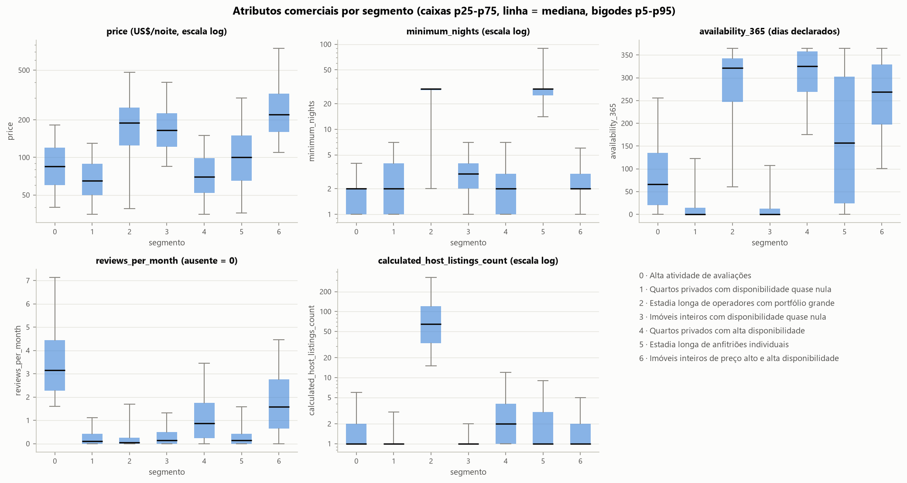

# Airbnb NYC: clusterização e segmentação de perfis comerciais

Projeto 06 da Mentoria em Ciência de Dados: aprendizado não supervisionado com **K-Means** e **DBSCAN** sobre os anúncios do
Airbnb em Nova York (snapshot de 2019).

> **Pergunta central:** como descobrir segmentos úteis de imóveis quando não existe uma variável-alvo que diga a qual grupo cada
> anúncio pertence?

**Resposta curta.** O resultado é um K-Means com **7 segmentos**, sobre uma representação comercial padronizada: preço, estadia
mínima, disponibilidade declarada, avaliações por mês, portfólio do anfitrião e tipo de imóvel.

- **Por que não o maior índice:** a solução não lidera nenhum índice isolado. Os líderes eram enganosos: K = 2 tem o maior
  Silhouette, mas põe 89% da base num grupo, e o K-Means sem padronização só fatia a disponibilidade.
- **Por que K = 7:** tem o melhor Davies-Bouldin, Silhouette no patamar mais alto, cobertura de 100%, estabilidade alta e perfis
  que se leem em unidades de negócio.
- **DBSCAN:** só reproduziu o tipo de imóvel ou deixou grande parte da amostra como ruído. Ficou como diagnóstico de anúncios
  atípicos.

| # | Segmento | % dos anúncios | Preço | Estadia mín. | Dias disponíveis | Avaliações/mês | Anúncios do anfitrião | Distância da Times Square (km)* |
|---|---|---|---|---|---|---|---|---|
| 0 | Alta atividade de avaliações | 15,3 | US$ 85 | 2 | 66 | 3,16 | 1 | 8,03 |
| 1 | Quartos privados com disponibilidade quase nula | 22,6 | US$ 65 | 2 | 0 | 0,10 | 1 | 7,67 |
| 2 | Estadia longa de operadores com portfólio grande | 4,8 | US$ 189 | 30 | 322 | 0,05 | 65 | 2,65 |
| 3 | Imóveis inteiros com disponibilidade quase nula | 26,5 | US$ 165 | 3 | 0 | 0,15 | 1 | 5,23 |
| 4 | Quartos privados com alta disponibilidade | 10,8 | US$ 70 | 2 | 325 | 0,88 | 2 | 8,88 |
| 5 | Estadia longa de anfitriões individuais | 8,4 | US$ 100 | 30 | 157 | 0,14 | 1 | 6,02 |
| 6 | Imóveis inteiros de preço alto e alta disponibilidade | 11,6 | US$ 220 | 2 | 269 | 1,59 | 1 | 5,66 |

Medianas nos valores originais. Fonte: [`artifacts/segment_profiles.csv`](artifacts/segment_profiles.csv), gerado por
`scripts/train.py`. O relatório para o negócio está em [`reports/relatorio_executivo.md`](reports/relatorio_executivo.md).

\* Coluna só **descritiva**: a distância em linha reta até a Times Square não faz parte da definição dos grupos. Ela foi testada
como feature num experimento opcional (R4, notebook 02, seção 11) e não foi adotada.



---

## 1. Dados

- **Fonte:** Kaggle, *New York City Airbnb Open Data* (`AB_NYC_2019.csv`, snapshot de 2019). Como obter e conferir o arquivo
  (SHA-256): [`data/README.md`](data/README.md). O arquivo não é versionado.
- **Volume:** 48.895 anúncios × 16 colunas. A **unidade de análise é o anúncio** (`id` único), e não reserva, pessoa ou
  hospedagem.
- **Limpeza:** 11 anúncios com `price = 0` foram excluídos, e 48.884 foram clusterizados.
- **Ausentes:** os 10.052 ausentes de `reviews_per_month` e `last_review` são exatamente os anúncios sem avaliação, ou seja, uma
  ausência estrutural.

## 2. Decisões principais

| Decisão | Escolha | Evidência |
|---|---|---|
| Features (R2) | `price`, `minimum_nights`, `availability_365`, `reviews_per_month`, `calculated_host_listings_count` + `room_type` (OneHot) | inventário de colunas e seção 10 do notebook 01 |
| Fora das features | IDs e texto; `neighbourhood` (221 categorias); `latitude`/`longitude` (só mapas e, no experimento opcional R4, convertidas em distância); `number_of_reviews` (ρ = 0,85 com `reviews_per_month`); `last_review` | notebook 01 |
| Tratamento | `reviews_per_month` ausente = 0; winsorização p99,5 em `price` (US$ 1.000) e `reviews_per_month` (7,97); teto de 365 em `minimum_nights`; `log1p`; `StandardScaler` | notebook 01, seção 9; notebook 02, seção 3 |
| Normalização | **com** `StandardScaler`: sem ela, `availability_365` é 99,98% da distância, e as partições com e sem escala concordam pouco (ARI 0,15) | notebook 02, seção 3 |
| K | **7**: melhor Davies-Bouldin (1,156), Silhouette 0,284 (patamar de K = 7–9), Calinski-Harabasz 1% abaixo do máximo, ARI 0,996 entre 5 sementes, menor grupo com 4,8% | notebook 02, seção 5 |
| DBSCAN | `eps` = 0,9 e `min_samples` = 16 na amostra de 10.000: 5,3% de ruído, clusters iguais a `room_type` (ARI 0,993); com cobertura idêntica, o K-Means tem Silhouette 0,299, contra 0,018 | notebook 02, seção 7 |
| Segmentação final | K-Means K = 7 em R2 padronizado | notebook 02, seção 9 |
| Distância até a Times Square (opcional) | **não adotada como feature**; fica como coluna descritiva | R4 (R2 + distância) concorda com R2 em ARI 0,725 e cria um grupo central (83,1% em Manhattan) que refina o segmento 6 por localização, sem perfil comercial novo; a partição passa a explicar 31,7% da variância da distância, contra 9,7% em R2 (notebook 02, seção 11) |

As 14 perguntas finais do enunciado são respondidas no notebook 02, seção 10.

## 3. Estrutura do repositório

```
├── README.md · requirements.txt · .gitignore · pytest.ini
├── data/README.md                  como obter o AB_NYC_2019.csv (não versionado)
├── notebooks/
│   ├── 01_eda.ipynb                hipóteses, inventário, EDA, limpeza e decisões de features
│   └── 02_clustering.ipynb         distâncias, experimento com e sem escala, K-Means, DBSCAN, perfis, PCA, mapa, decisão
│                                   e experimento opcional R4 (distância até a Times Square)
├── src/                            funções compartilhadas por notebooks, scripts e testes
│   ├── config.py                   caminhos, features, sementes, grades e K final
│   ├── data.py                     leitura, schema, SHA-256, auditoria e limpeza
│   ├── geo.py                      distância em km (haversine) até a Times Square
│   ├── preprocessing.py            ColumnTransformer (tratamento, scaler, OneHot, distância na R4) e pipeline K-Means
│   ├── evaluation.py               métricas com regra de validade, varredura de K, DBSCAN e distâncias
│   ├── profiling.py                perfis, composição, representatividade e nomes dos segmentos
│   ├── segmentation.py             validação de entrada e atribuição de segmentos a anúncios novos
│   ├── artifacts.py                salvar e carregar o pipeline com conferência de SHA-256
│   └── plots.py                    gráficos (tema e pequenos múltiplos)
├── scripts/
│   ├── train.py                    treina e salva o pipeline K-Means escolhido
│   ├── segment.py                  aplica o pipeline salvo a um CSV novo, sem retreinar
│   └── dbscan_experiments.py       reproduz os experimentos de DBSCAN
├── configs/segment_names.json      nomes, descrições e assinatura de tamanho dos segmentos
├── artifacts/                      pipeline, metadados, perfis, rótulos do treino e saídas do DBSCAN
├── reports/                        tabelas, figuras e relatório executivo
└── tests/                          testes (melhoria opcional)
```

## 4. Como reproduzir

Ambiente de referência: Python 3.11.9 no Windows 11. As versões estão fixadas em `requirements.txt`.

```bash
python -m venv .venv
```

```bash
.venv\Scripts\activate
```

```bash
python -m pip install -r requirements.txt
```

No Linux ou macOS, ative com `source .venv/bin/activate`. Se a rede intercepta HTTPS (antivírus ou proxy corporativo), passe o
certificado com `--cert <arquivo.pem>`. Depois, coloque o `AB_NYC_2019.csv` em `data/` (ver [`data/README.md`](data/README.md)).

**1. Notebooks**, executados de ponta a ponta, na ordem, com o `.venv` ativado:

```bash
python -m jupyter nbconvert --to notebook --execute --inplace notebooks/01_eda.ipynb
```

```bash
python -m jupyter nbconvert --to notebook --execute --inplace notebooks/02_clustering.ipynb
```

**2. Treino do K-Means final.** O script grava `artifacts/kmeans_pipeline.joblib`, `metadata.json`, `segment_profiles.csv` e
`train_assignments.csv`:

```bash
python scripts/train.py
```

**3. Segmentação de anúncios novos, sem retreinar.** A entrada segue o schema do `AB_NYC_2019.csv`. As colunas mínimas são `id`,
`price`, `minimum_nights`, `availability_365`, `reviews_per_month`, `calculated_host_listings_count` e `room_type`. A saída tem
`id, cluster, segment_name, status`, na ordem da entrada:

```bash
python scripts/segment.py --input data/novos_anuncios.csv --output data/segmentos.csv
```

Linhas fora do domínio do treino ficam **sem segmento**, com o motivo em `status`: preço < 1, valor obrigatório ausente,
`room_type` desconhecido, `availability_365` fora de [0, 365] etc. `reviews_per_month` vazio é aceito e significa "sem
avaliações". Aplicado ao próprio `AB_NYC_2019.csv`, o script reproduz os 48.884 rótulos do treino e deixa sem segmento só os 11
anúncios de preço zero.

**4. Experimentos de DBSCAN.** O script grava em `artifacts/dbscan/` as grades R2 e R1, os rótulos da configuração de referência
(id, rótulo, core/border/noise), o perfil com o ruído e `params.json`:

```bash
python scripts/dbscan_experiments.py
```

O DBSCAN **não tem `predict`**: esses rótulos valem só para a amostra do ajuste, e o projeto não simula inferência para anúncios
novos.

**5. Testes** (melhoria opcional):

```bash
python -m pytest -q
```

## 5. Artefatos

| Arquivo | Conteúdo |
|---|---|
| `artifacts/kmeans_pipeline.joblib` | `Pipeline` completo: tratamento, `StandardScaler`, OneHot e `KMeans(K = 7)` |
| `artifacts/metadata.json` | SHA-256 do modelo e dos dados, features, limites aprendidos, parâmetros, tamanhos, métricas, nomes e versões |
| `artifacts/segment_profiles.csv` | tabela de rótulos e perfis: nome, descrição, tamanho, quartis de preço e disponibilidade, estadia, avaliações, portfólio e, como coluna descritiva, a distância mediana até a Times Square |
| `artifacts/train_assignments.csv` | `id` e `cluster` de cada anúncio do treino |
| `artifacts/dbscan/` | grades, rótulos de referência, perfil com ruído, ruído por segmento do K-Means e parâmetros |
| `configs/segment_names.json` | nomes dados depois da análise, com a assinatura de tamanhos conferida pelo `train.py` |

## 6. Obrigatório × opcional

- **Obrigatório (enunciado):**
  - notebooks 01 e 02;
  - os três scripts;
  - pipeline salvo, configuração e tabela de perfis;
  - relatório executivo;
  - README, `requirements.txt` e `.gitignore`.
- **Melhorias opcionais:**
  - suíte `pytest` (33 testes);
  - DBSCAN só numérico (R1, experimento complementar);
  - representações alternativas R1 e R3 no K-Means;
  - checagem de estabilidade por ARI entre sementes;
  - curva de k-distâncias, que o enunciado recomenda;
  - medida de "segmentos mais distintos" pela distância do centróide ao centro da base;
  - experimento R4 com a distância até a Times Square (notebook 02, seção 11) e essa distância como coluna descritiva dos
    perfis.

## 7. Checklist do enunciado

- [x] Pergunta de negócio e quatro hipóteses (notebook 01, seção 1).
- [x] Duplicatas, ausentes, valores extremos e qualidade das variáveis (notebook 01, seções 2–4).
- [x] Justificativa de cada feature e de por que IDs não são contínuas (inventário de colunas e seção 10 do notebook 01).
- [x] Numéricas e uma categórica com encoding adequado (R2: 5 numéricas + `room_type` em OneHot).
- [x] Comparação com e sem normalização, controlando as demais escolhas (notebook 02, seção 3).
- [x] Distância, centróides e função objetivo do K-Means explicados (notebook 02, seções 2 e 4).
- [x] Múltiplos K, com Elbow, Silhouette, Davies-Bouldin e Calinski-Harabasz (notebook 02, seção 5).
- [x] Escolha de K e tamanhos dos grupos interpretados (notebook 02, seção 5).
- [x] `eps`, `min_samples`, core, border e noise explicados (notebook 02, seção 7.1).
- [x] Clusters, % de ruído e métricas reportados só quando válidos (notebook 02, seções 7.4–7.6).
- [x] Comparação justa K-Means × DBSCAN: mesma amostra, mesmo espaço e mesma cobertura (notebook 02, seção 7.7).
- [x] PCA 2D, mapa e perfis comerciais (notebook 02, seção 8).
- [x] Comparação com `room_type` e `neighbourhood_group`, sem tratá-la como validação independente (notebook 02, seção 8.1).
- [x] Relatório de negócio, limitações e conclusão técnica (`reports/relatorio_executivo.md`; notebook 02, seções 9 e 10).
- [x] Scripts, pipeline salvo, README, `requirements.txt` e execução reproduzível.

## 8. Limitações

- **Medidas indiretas:** `availability_365` é disponibilidade **declarada**, e não ocupação. Avaliações não medem reservas,
  receita nem satisfação. Nada aqui é causal.
- **Separação moderada:** o Silhouette de 0,28 mostra que os segmentos são regiões de um contínuo, com fronteiras difusas, e que
  os nomes resumem tendências.
- **Sem validação externa:** não existe rótulo verdadeiro. `room_type` faz parte da definição dos grupos, então comparar com ele
  não valida a solução.
- **Peso dos operadores:** a segmentação é de anúncios, então anfitriões com muitos anúncios pesam mais (o maior tem 327).
- **Amostras:** o Silhouette (5.000 linhas) e o DBSCAN (10.000 linhas) usam amostras fixas, com semente 42.
- **Dependência do ambiente:** a numeração dos clusters depende dos dados e das versões das bibliotecas. O `train.py` confere a
  assinatura de tamanhos antes de gravar os nomes. Retreinar também pode mudar o SHA-256 do arquivo do pipeline sem mudar os
  rótulos: a ordem das somas paralelas do K-Means gera diferenças da ordem de 10⁻¹⁶ nos centróides.
- **Atualidade:** os dados são de 2019. Usar os segmentos hoje exigiria reaplicar o pipeline a dados atuais e revisar os perfis.
