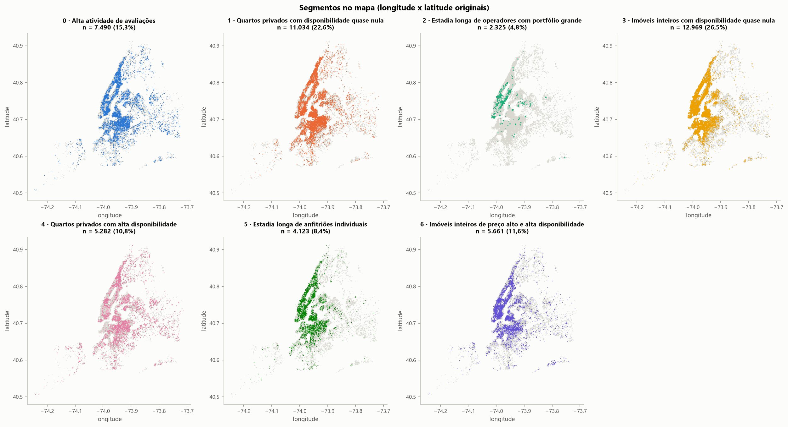

# Relatório executivo: segmentação de anúncios do Airbnb em Nova York (2019)

**Pergunta.** Como descobrir segmentos úteis de imóveis quando não existe uma variável que diga a qual grupo cada anúncio pertence?

**Dados.** O snapshot histórico de 2019 do Kaggle (`AB_NYC_2019.csv`) tem 48.895 anúncios. Foram usados 48.884: os 11 com
preço zero saíram. A unidade de análise é o **anúncio**, e não reservas ou hóspedes. O retrato não descreve o mercado atual.

## Como os segmentos foram obtidos

- **Representação.** Cada anúncio é descrito por preço, estadia mínima, disponibilidade declarada no ano, avaliações por mês,
  número de anúncios do anfitrião e tipo de imóvel. As variáveis assimétricas recebem log e limite de extremos, e as numéricas são
  padronizadas. Localização e bairro ficam fora da definição dos grupos.
- **Escala.** A padronização é decisiva. Sem ela, a disponibilidade responde por **99,98%** da distância entre anúncios, e
  qualquer agrupamento vira só "faixas de disponibilidade".
- **Algoritmo.** K-Means com 7 grupos. O K foi escolhido comparando K = 2 a 10 por quatro métricas internas, tamanho dos grupos,
  estabilidade e leitura de negócio. O DBSCAN foi testado como alternativa.

## Segmentos encontrados (medianas)

| Segmento | Anúncios | Preço | Estadia mín. | Dias disponíveis | Avaliações/mês | Anúncios do anfitrião |
|---|---|---|---|---|---|---|
| Imóveis inteiros com disponibilidade quase nula | 26,5% | US$ 165 | 3 | 0 | 0,15 | 1 |
| Quartos privados com disponibilidade quase nula | 22,6% | US$ 65 | 2 | 0 | 0,10 | 1 |
| Alta atividade de avaliações | 15,3% | US$ 85 | 2 | 66 | **3,16** | 1 |
| Imóveis inteiros de preço alto e alta disponibilidade | 11,6% | **US$ 220** | 2 | 269 | 1,59 | 1 |
| Quartos privados com alta disponibilidade | 10,8% | US$ 70 | 2 | **325** | 0,88 | 2 |
| Estadia longa de anfitriões individuais | 8,4% | US$ 100 | **30** | 157 | 0,14 | 1 |
| Estadia longa de operadores com portfólio grande | 4,8% | US$ 189 | **30** | 322 | 0,05 | **65** |

Os grupos se separam em uma ou duas variáveis cada e se sobrepõem nas demais (Silhouette de 0,28). São **regiões de um contínuo**,
não grupos isolados, e os nomes resumem tendências. O distrito não entrou na definição. Ainda assim, o segmento de operadores de
estadia longa tem 83% dos anúncios em Manhattan, contra 44% na base. Os demais ficam próximos da distribuição da cidade. A maior
diferença é o peso de Queens nos quartos privados de alta disponibilidade: 22%, contra 12% na base.

## Comparação entre abordagens

| Abordagem | O que produziu | Por que não foi escolhida (ou foi) |
|---|---|---|
| K-Means, **K = 7**, com padronização | 7 perfis distintos, menor grupo com 4,8%; estável entre sementes (ARI 0,996) | **escolhida**: melhor Davies-Bouldin (1,156), Silhouette no patamar mais alto (0,284) e cobertura de 100% |
| K-Means, K = 2 | maior Silhouette (0,392) | um grupo com 89% dos anúncios: inútil para segmentar |
| K-Means sem padronização | Silhouette de 0,73 | só fatia a disponibilidade; índice alto, segmentação vazia |
| DBSCAN (`eps` 0,9, `min_samples` 16, amostra de 10 mil) | 5,3% de ruído; grupos idênticos ao tipo de imóvel (ARI 0,993) | separação tautológica; sem `predict` para anúncios novos |

O DBSCAN foi útil como **diagnóstico**. O ruído dele se concentra nos anúncios atípicos (estadias longas e alta disponibilidade),
e com raio menor ele revela grupos de anúncios quase idênticos de um mesmo operador.

## Recomendações

1. **Revisar o inventário de baixa atividade antes de qualquer outra ação.**
   - *O quê:* os dois segmentos de disponibilidade quase nula somam **24.003 anúncios (49% da base)**. Neles, 66% declaram zero dia
     disponível e, entre os anúncios com avaliação, **60% tiveram a última antes de 2019**, contra 15% nos demais segmentos.
   - *Ação:* começar por uma checagem de calendário e atividade.
   - *Cautela:* disponibilidade zero pode ser calendário lotado ou bloqueado, e não prova abandono. A recomendação é verificar, não
     remover.
2. **Atender o segmento de operadores de estadia longa como contas, não como público de massa.**
   - *O quê:* os 2.325 anúncios vêm de só **63 anfitriões**, e os 5 maiores respondem por 38% deles. Exigem 30 noites, ficam
     disponíveis quase o ano todo e quase não recebem avaliações.
   - *Ação:* uma comunicação de média duração com poucos interlocutores tende a alcançar o segmento inteiro.
   - *Cautela:* o grupo depende de poucos operadores (o maior tem 14% dos anúncios), e os dados não cobrem regras locais de
     locação nem resultados financeiros.
3. **Usar os segmentos como estratos de comparação e de teste, não como metas.**
   - *O quê:* por exemplo, comparar preço e comunicação dentro de "imóveis inteiros de preço alto e alta disponibilidade" (US$ 220)
     e dentro de "imóveis inteiros com disponibilidade quase nula" (US$ 165), em vez de usar a média da cidade.
   - *Ação:* antes de mudar preço ou comunicação, testar a ação com um grupo de controle dentro do mesmo segmento.
   - *Cautela:* sem dados de ocupação e receita, não dá para afirmar que um perfil "rende mais".

## Limitações

- **Medidas indiretas:** `availability_365` é disponibilidade **declarada**, e não ocupação. Avaliações não medem reservas,
  receita nem satisfação. Nenhuma conclusão causal decorre da segmentação.
- **Validação:** não existe rótulo verdadeiro. O tipo de imóvel faz parte da definição dos grupos, então comparar com ele não
  valida nada.
- **Unidade de análise:** a segmentação é de **anúncios**. Um operador com 327 anúncios pesa 327 vezes.
- **Dados:** são de 2019. Antes de usar os segmentos hoje, seria preciso reaplicar o pipeline a dados atuais e revisar os perfis.

*Reprodução, decisões e detalhes técnicos: [README](../README.md) e os notebooks `01_eda.ipynb` e `02_clustering.ipynb`.*
